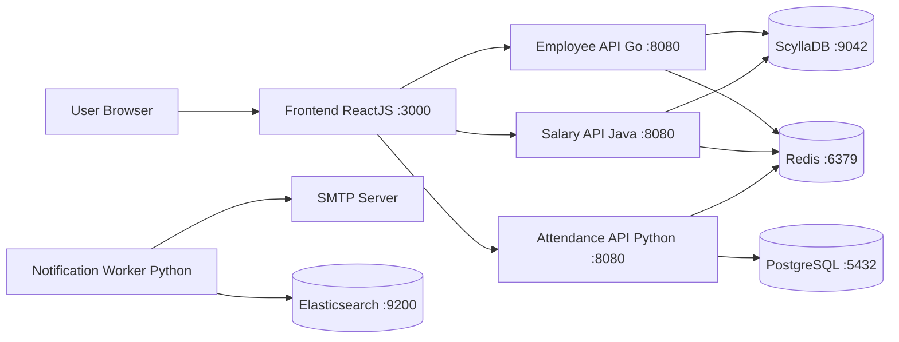

# OT-Microservices: Detailed Analysis README

Ye document OT-MICROSERVICES ke 5 repositories ka analysis hai: **employee-api, salary-api, attendance-api, frontend** aur **notification-worker**. Har repo ka alag section hai. Jo cheez tabular ho sakti thi (ports, libraries, endpoints, files) wo table me hai, aur jo samjhane wali baat thi wo paragraph me.

> **Source of information:** Har repo ka README.md, aur dependency/config files (`go.mod`, `pom.xml`, `pyproject.toml`, `package.json`, `requirements.txt`, `config.yaml`, `Dockerfile` jahan padhi gayi). Source code ke andar ki `.go` / `.py` / `.java` files line-by-line nahi padhi gayi, isliye folder ka purpose naam aur README ke hisaab se likha gaya hai, jahan ye inference hai wahan "(inference)" likha hai.

---

## 1. Poora Architecture ek nazar me

Ye 5 repos mil kar ek Employee Management system banate hain. **Frontend** user ko UI deta hai aur teen REST APIs (Employee, Attendance, Salary) ko call karta hai. Employee aur Salary APIs data **ScyllaDB** me rakhti hain, jabki Attendance API data **PostgreSQL** me rakhti hai. Teeno APIs **Redis** ko cache ki tarah use karti hain. **Notification Worker** alag se chalne wala ek scheduled job hai jo SMTP ke through mail bhejta hai aur Elasticsearch se connect hota hai.



### Quick comparison

| Parameter | Employee API | Salary API | Attendance API | Frontend | Notification Worker |
|---|---|---|---|---|---|
| Language | Go (1.20) | Java 17 | Python 3.11+ | JavaScript (ReactJS) | Python 3 |
| Framework | Gin | Spring Boot 3.1.1 | Flask | React 16 + react-scripts | Plain script (koi web framework nahi) |
| Web server | Gin ka built-in HTTP server | Embedded Tomcat | Gunicorn | `serve` (static server) | Nahi hai (web server nahi chalata) |
| Primary DB | ScyllaDB | ScyllaDB | PostgreSQL | Koi DB nahi | Koi DB nahi (Elasticsearch se connect) |
| Cache | Redis | Redis | Redis | Nahi | Nahi |
| Build tool | Make + go build | Maven (mvnw) + Make | Poetry + Make | npm + Make | Make + pip |
| DB migration tool | `migration.json` + `make run-migrations` | golang-migrate (`migration.json`) | Liquibase (`liquibase.properties`) | N/A | N/A |
| App port | 8080 | 8080 | 8080 | 3000 | Koi nahi (outgoing only) |
| Swagger / API docs | `/swagger/index.html` | `/salary-documentation` | `/apidocs` | N/A | N/A |
| Metrics | `/metrics` (Prometheus) | `/actuator/prometheus` | `/metrics` (Prometheus) | N/A | N/A |

---

## 2. Employee API

**Repo:** `OT-MICROSERVICES/employee-api`

Employee API ek **Golang** based microservice hai jo OT-Microservices me employee se jude saare transactions handle karti hai. Isme employee create karna, search karna, aur location ya designation ke hisaab se count aur information nikalna shamil hai. Ye Gin framework par bani hai, primary data ScyllaDB me store karti hai, aur Redis ko optional cache ke roop me use karti hai. Config me `redis.enabled` by default `false` hai, yani Redis ke bina bhi app chal sakti hai. API ke saath Swagger documentation aur Prometheus metrics bhi diye gaye hain.

### Tech stack

| Category | Detail |
|---|---|
| Language | Go 1.20 |
| Web framework | Gin (`gin-gonic/gin v1.9.1`) |
| Primary database | ScyllaDB |
| Cache | Redis (optional, default disabled) |
| ScyllaDB driver | `gocql v1.5.2`, jo `go.mod` me `replace` se **`scylladb/gocql v1.10.0`** par point kiya gaya hai |
| Redis driver | `redis/go-redis/v9 v9.0.5` |
| Config reading | `spf13/viper` (config.yaml padhne ke liye) |
| Logging | `sirupsen/logrus` |
| Metrics | `penglongli/gin-metrics` (Prometheus) |
| API docs | `swaggo/swag`, `swaggo/gin-swagger`, `swaggo/files` |
| Testing | `stretchr/testify`, `go test` |
| License | Apache-2.0 |

### Ports aur connectivity

| Component | Host / Port | Note |
|---|---|---|
| Employee API | `8080` | Swagger URL `localhost:8080/swagger/index.html` se confirm hota hai |
| ScyllaDB | `172.17.0.3:9042` | `config.yaml` ka sample; username `scylladb`, keyspace `employee_db` |
| Redis | `172.17.0.4:6379` | `config.yaml` ka sample; `enabled: false`, database `0` |

Ye IPs Docker ke default bridge network ke sample values hain, asli deployment me inhe apne hisaab se badalna hoga.

### Endpoints

| Endpoint | Method | Kaam |
|---|---|---|
| `/metrics` | GET | Prometheus metrics aur performance info |
| `/api/v1/employee/health` | GET | Shallow health check |
| `/api/v1/employee/health/detail` | GET | Detailed health, ScyllaDB aur Redis dono ki status ke saath |
| `/api/v1/employee/create` | POST | JSON body se naya employee add karta hai |
| `/api/v1/employee/search` | GET | URL params se employee search |
| `/api/v1/employee/search/all` | GET | Saare employees ki search |
| `/api/v1/employee/search/location` | GET | Location ka count aur information |
| `/api/v1/employee/search/designation` | GET | Designation ka count aur information |
| `/swagger/index.html` | GET | Swagger UI |

### Files aur folders

| File / Folder | Kis liye hai |
|---|---|
| `main.go` | Application ka entry point |
| `api/` | Request handlers (inference, README ke test list me hai) |
| `client/` | ScyllaDB aur Redis ke clients/connections (inference) |
| `config/` | `config.yaml` ko load karne ka code (inference) |
| `middleware/` | Gin middleware, jaise logging ya metrics (inference) |
| `routes/` | URL routes ki definition (inference) |
| `model/` | Data models/structs (inference) |
| `docs/` | Swagger se generate hui documentation |
| `migration/` | Database migration scripts (keyspace aur table banane ke liye) |
| `static/` | Logo aur architecture diagram images |
| `config.yaml` | ScyllaDB aur Redis ke connection settings |
| `migration.json` | Migration ke liye DB connection details |
| `Makefile` | `make build`, `make docker-build`, `make run-migrations` jaise commands |
| `Dockerfile` | Docker image banane ke liye |
| `go.mod` / `go.sum` | Go dependencies aur unke checksums |
| `.gitignore`, `LICENSE`, `README.md` | Standard repo files |

### Build, test aur run

```bash
make build                # binary build
make docker-build         # docker image
make run-migrations       # ScyllaDB me keyspace aur table banata hai
export GIN_MODE=release   # debugging ke liye development
./employee-api            # app start

# Unit tests
go test $(go list ./... | grep -v docs | grep -v model | grep -v main.go) -coverprofile cover.out
```

Test cases sirf in packages ke liye hain: `api`, `client`, `config`, `middleware`, `routes`.

---

## 3. Salary API

**Repo:** `OT-MICROSERVICES/salary-api`

Salary API ek **Java** microservice hai jo salary ke records aur transactions handle karti hai. Ye Spring Boot par bani hai aur isme embedded Tomcat web server chalta hai. Data ScyllaDB me store hota hai (Spring Data Cassandra ke through) aur Redis cache ke roop me use hota hai. GitHub par repo ka description galti se "attendance related data" likha hai, jabki README ke hisaab se ye salary data ke liye hai.

### Tech stack

| Category | Detail |
|---|---|
| Language | Java 17 |
| Framework | Spring Boot 3.1.1 (`spring-boot-starter-web`) |
| Web server | Embedded Tomcat |
| Primary database | ScyllaDB (`spring-boot-starter-data-cassandra`) |
| Cache | Redis (`spring-boot-starter-data-redis`) |
| Database driver | Spring Data Cassandra ke through DataStax Java driver, aur Redis ke liye Spring ka default client (inference, Spring Boot ke defaults ke hisaab se) |
| Health / metrics | `spring-boot-starter-actuator`, `micrometer-registry-prometheus` |
| API docs | `springdoc-openapi-starter-webmvc-ui 2.0.3` |
| Logging | `logstash-logback-encoder 6.6` (JSON logs) |
| Boilerplate reduction | Lombok |
| Build tool | Maven (`mvnw` wrapper bhi hai) |
| Code quality / testing | Checkstyle, JUnit, JaCoCo 0.8.7 (coverage) |
| DB migration | `golang-migrate/migrate` tool |

> **Observation:** README me "Open-telemetry metrics support" likha hai, lekin `pom.xml` me OpenTelemetry ki koi dependency nahi dikhi, sirf Micrometer Prometheus registry hai. Interview me is farq ke baare me soch kar jao.

### Ports aur connectivity

| Component | Port | Note |
|---|---|---|
| Salary API | `8080` | Swagger `localhost:8080/salary-documentation` |
| ScyllaDB | `9042` (default) | Asli host/port `src/main/resources/application.yml` me set hota hai |
| Redis | `6379` (default) | Wahi `application.yml` |

### Endpoints

| Endpoint | Method | Kaam |
|---|---|---|
| `/api/v1/salary/create/record` | POST | JSON body se salary record add karta hai |
| `/api/v1/salary/search` | GET | URL params se search |
| `/api/v1/salary/search/all` | GET | Saare records ki search |
| `/actuator/prometheus` | GET | Prometheus metrics |
| `/actuator/health` | GET | Shallow health check |

### Files aur folders

| File / Folder | Kis liye hai |
|---|---|
| `pom.xml` | Maven config: dependencies, plugins, Java version, Spring Boot parent |
| `mvnw`, `mvnw.cmd`, `.mvn/wrapper` | Maven wrapper, bina Maven install kiye build chalane ke liye |
| `src/main/java/com/opstree/microservice/salary/` | Main Java code. `pom.xml` ke excludes se pata chalta hai ki yahan `controller`, `service` aur `repository` packages hain |
| `src/main/resources/application.yml` | Application configuration (DB, Redis connection) |
| `src/test/java/com/opstree/microservice/salary` | Unit test cases |
| `migration/` | Database migration scripts |
| `migration.json` | Migration tool ke liye connection details |
| `Makefile` | `make build`, `make docker-build`, `make docker-push`, `make fmt`, `make test`, `make run-migrations` |
| `Dockerfile` | Docker image ke liye |
| `static/` | Logo aur architecture image |

### Build, test aur run

```bash
make build
make run-migrations
java -jar target/salary-0.1.0-RELEASE.jar

mvn checkstyle:checkstyle   # code quality
mvn test                    # unit test + coverage
```

Note: `pom.xml` me surefire aur jacoco plugin me `controller`, `service` aur `repository` packages exclude kiye gaye hain, yani unke liye unit tests ya coverage count nahi hota.

---

## 4. Attendance API

**Repo:** `OT-MICROSERVICES/attendance-api`

Attendance API ek **Python** microservice hai jo attendance ke saare records handle karti hai. Ye Flask framework par bani hai aur **PostgreSQL** me data rakhti hai, jabki baaki do APIs (Employee, Salary) ScyllaDB use karti hain. Database se baat karne ke liye ye Peewee ORM aur psycopg2 driver use karti hai. Redis API responses ko cache karne ke liye hai. Database schema ki migration yahan **Liquibase** se hoti hai, aur app ko production jaisa chalane ke liye Gunicorn use hota hai.

### Tech stack

| Category | Detail |
|---|---|
| Language | Python `^3.11` |
| Framework | Flask `^2.3.2` |
| Web server | Gunicorn (`gunicorn app:app --log-config log.conf -b 0.0.0.0:8080`) |
| Primary database | PostgreSQL |
| PostgreSQL driver | `psycopg2 ^2.9.6` |
| ORM | `peewee ^3.16.2` |
| Cache | Redis (`redis ^4.6.0`) aur `flask-caching ^2.0.2` |
| Input validation | `voluptuous ^0.13.1` |
| API docs | `flasgger 0.9.7b2` (Swagger) |
| Metrics | `prometheus-flask-exporter ^0.22.4` |
| Logging | `json-logging-py`, `jsonformatter`, `python-json-logger` |
| Package manager | Poetry |
| Testing | `pytest`, `pytest-mock`, `pytest-cov` |
| Code quality | `pylint` (`make fmt` se) |
| DB migration | Liquibase |

> **Observation:** `pyproject.toml` me `Flask`, `psycopg2` aur `PyYAML` `dev` group me hain, aur Gunicorn dependency list me nahi dikha. Production image me ye kaise install hote hain, ye `Dockerfile` se verify karna chahiye.

### Ports aur connectivity

| Component | Host / Port | Note |
|---|---|---|
| Attendance API | `8080` | Gunicorn bind `0.0.0.0:8080`, Swagger `localhost:8080/apidocs` |
| PostgreSQL | `172.17.0.3:5432` | `config.yaml` sample: database `attendance_db`, user `postgres` |
| Redis | `172.17.0.4:6379` | `config.yaml` sample: password khali |

### Endpoints

| Endpoint | Method | Kaam |
|---|---|---|
| `/metrics` | GET | Prometheus metrics |
| `/apidocs` | GET | Swagger UI |
| `/api/v1/attendance/create` | POST | JSON body se attendance record add |
| `/api/v1/attendance/search` | GET | URL params se search |
| `/api/v1/attendance/search/all` | GET | Saare records ki search |
| `/api/v1/attendance/health` | GET | Shallow health check |
| `/api/v1/attendance/health/detail` | GET | Detailed health, PostgreSQL aur Redis ke saath |

### Files aur folders

| File / Folder | Kis liye hai |
|---|---|
| `app.py` | Application ka entry point (Gunicorn isi ko `app:app` se load karta hai) |
| `router/` | API routes aur request handling (inference) |
| `models/` | Peewee ORM models, yani database tables (inference) |
| `client/` | PostgreSQL aur Redis ke clients (inference) |
| `utils/` | Helper functions (inference) |
| `scripts/` | Helper scripts |
| `migration/` | Liquibase changelog files |
| `liquibase.properties` | Liquibase ke liye DB connection details |
| `config.yaml` | PostgreSQL aur Redis connection settings |
| `log.conf` | Gunicorn/Python logging configuration |
| `pyproject.toml` | Poetry config aur dependencies |
| `poetry.lock` | Exact dependency versions ka lock |
| `pytest.ini` | Pytest settings |
| `Makefile` | `make build`, `make docker-build`, `make fmt`, `make run-migrations` |
| `Dockerfile` | Docker image |
| `static/` | Logo aur architecture image |

### Build, test aur run

```bash
make build                 # poetry se dependencies install
make run-migrations        # Liquibase se schema banana
gunicorn app:app --log-config log.conf -b 0.0.0.0:8080

python3 -m pytest
python3 -m pytest --cov=.  # coverage
```

Tests in modules ke liye hain: `router`, `client`, `models`, `utils`.

---

## 5. Frontend

**Repo:** `OT-MICROSERVICES/frontend`

Frontend ek **ReactJS** application hai jo OT-Microservices stack ka main UI hai. Ye khud koi database use nahi karta, balki Employee, Attendance aur Salary APIs par depend karta hai, isliye in teeno ko pehle chalana zaroori hai. Docker image me pehle `npm run build` se production build banta hai, phir `serve` naam ka static file server us build ko port 3000 par serve karta hai.

### Tech stack

| Category | Detail |
|---|---|
| Language | JavaScript |
| UI framework | React `^16.2.0`, `react-dom` |
| Build tooling | `react-scripts ^2.0.3` (Create React App) |
| UI components | Material-UI v4 (`@material-ui/core`), `reactstrap`, `tabler-react`, `material-table` |
| Forms aur validation | `formik`, `react-formik-ui`, `yup` |
| Routing | `react-router-dom ^5` |
| Charts aur maps | `react-c3js`, `d3-scale`, `react-google-maps`, `react-simple-maps` |
| PDF | `@progress/kendo-react-pdf`, `@progress/kendo-drawing` |
| Monitoring | `@elastic/apm-rum-react` (Elastic APM real user monitoring) |
| Package manager | npm |
| Docker base image | `node:16.15.1` |
| Static server | `serve -s build` (yarn se global install) |

### Ports aur connectivity

| Component | Port | Note |
|---|---|---|
| Frontend | `3000` | Dockerfile me `EXPOSE 3000`; `package.json` me `proxy` bhi `http://localhost:3000` hai |
| Employee API | `8080` | Backend dependency |
| Attendance API | `8080` | Backend dependency |
| Salary API | `8080` | Backend dependency |

Teeno backend APIs default me 8080 par chalti hain, isliye ek hi machine par chalane par port conflict hoga. Alag hosts/containers ya alag mapped ports use karne padenge.

### Files aur folders

| File / Folder | Kis liye hai |
|---|---|
| `src/` | React source code, components aur pages |
| `public/` | Static files, jaise `index.html` aur icons |
| `static/` | Logo aur architecture image (README ke liye) |
| `package.json` | Dependencies aur scripts (`start`, `build`, `test`, `deploy`) |
| `Makefile` | `make build`, `make docker-build`, `make docker-run` |
| `Dockerfile` | Node image, build, aur `serve` se app chalata hai |

### Build aur run

```bash
make build         # npm install
make docker-build  # docker image
make docker-run    # container chalana
```

---

## 6. Notification Worker

**Repo:** `OT-MICROSERVICES/notification-worker`

Notification Worker ek **Python** service hai jo employees ko **mail notifications** bhejti hai. Ye baaki 3 APIs ki tarah web server nahi hai, yani isme koi port listen nahi karta aur koi REST endpoint nahi hai. Ye ek scheduled job ki tarah chalta hai. `--mode` flag se iska behaviour control hota hai: `scheduled` mode me ye har mahine ki shuruaat me chalta hai, aur `external` mode me sirf ek baar chalkar band ho jata hai. Mail bhejne ke liye ye SMTP server par depend karta hai, aur config me Elasticsearch ke connection details bhi lagte hain.

### Tech stack

| Category | Detail |
|---|---|
| Language | Python 3 |
| Entry script | `notification_api.py` |
| Mail library | `emails==0.6` |
| Elasticsearch client | `elasticsearch==7.8.0` |
| Config reading | `config-with-yaml==0.1.0` |
| Scheduling | `schedule==0.6.0` |
| Mail transport | SMTP server (dependency) |
| Data/search backend | Elasticsearch (config se connect hota hai) |

### Flags

| Flag | Value | Behaviour |
|---|---|---|
| `-h`, `--help` | N/A | Help dikhata hai |
| `-m`, `--mode` | `scheduled` | Har mahine ki shuruaat me chalta hai |
| `-m`, `--mode` | `external` | Ek baar chalta hai |

### Connectivity

| Component | Host / Port | Note |
|---|---|---|
| SMTP server | Sample `test.smtp.com:25` | Mail bhejne ke liye; port aur credentials config se aate hain |
| Elasticsearch | Sample `172.17.0.2:9200` | Config me `username`/`password`/`host`/`port` dena hota hai |

README me ye nahi likha ki worker Elasticsearch se exactly kya data padhta hai. Is baare me kuch bhi pakka kehne ke liye `notification_api.py` ka code padhna padega.

### Environment variables

| Variable | Default | Kaam |
|---|---|---|
| `CONFIG_FILE` | `/app/config.yaml` | Config file ka path |
| `FROM` | N/A | Sender ka naam |
| `SMTP_USERNAME` | N/A | SMTP username |
| `SMTP_PASSWORD` | N/A | SMTP password |
| `SMTP_SERVER` | N/A | SMTP server ka naam |
| `SMTP_PORT` | N/A | SMTP server ka port |
| `ELASTIC_USERNAME` | N/A | Elasticsearch username |
| `ELASTIC_PASSWORD` | N/A | Elasticsearch password |
| `ELASTIC_HOST` | N/A | Elasticsearch ka DNS ya IP |
| `ELASTIC_PORT` | N/A | Elasticsearch ka port |

### Files

| File | Kis liye hai |
|---|---|
| `notification_api.py` | Main script, scheduling aur mail logic |
| `config.yaml` | SMTP aur Elasticsearch connection settings |
| `entrypoint.sh` | Container start hone par chalne wali script |
| `requirements.txt` | Python dependencies |
| `Dockerfile` | Docker image |
| `Makefile` | `make build`, `make build-image` |

### Run

```bash
export CONFIG_FILE=/path/to/config.yaml
python3 notification_api.py                    # ya: python3 notification_api.py --mode external
make build-image                               # docker image
```

---

## 7. Interview ke liye yaad rakhne wali baatein

| Sawal | Jawab |
|---|---|
| Kaun si API kis language me hai? | Employee: Go, Salary: Java, Attendance: Python, Frontend: JavaScript (React), Notification Worker: Python |
| Kaun si API ScyllaDB use karti hai? | Employee aur Salary |
| Kaun si API PostgreSQL use karti hai? | Sirf Attendance |
| Redis kaun use karta hai? | Employee (optional), Salary aur Attendance |
| Teeno APIs ka default port kya hai? | `8080` |
| Frontend ka port? | `3000` |
| Notification worker ka port? | Koi nahi, ye web server nahi hai |
| Kaun sa migration tool kahan? | Attendance: Liquibase, Salary: golang-migrate, Employee: `migration.json` aur `make run-migrations` |
| Employee API me ScyllaDB ka driver? | `scylladb/gocql v1.10.0` (gocql ka replace) |
| Attendance me PostgreSQL ka driver aur ORM? | `psycopg2` aur Peewee |
| Salary API ka web server? | Embedded Tomcat (Spring Boot) |
| Attendance API ka web server? | Gunicorn |
| Frontend kaise serve hota hai? | `npm run build` ke baad `serve -s build` |

---

## 8. Jo cheezein verify nahi ho paayin

| Cheez | Status |
|---|---|
| `employee-api`, `salary-api`, `attendance-api`, `notification-worker` ki `Dockerfile` aur `Makefile` ka exact content | Nahi padhi gayi. Port aur base image README aur config files se liye gaye hain |
| Salary API ka `application.yml` | Nahi padha, isliye ScyllaDB/Redis ke ports default values se likhe hain |
| Source code ke andar ka logic (`.go`, `.py`, `.java`, `.js`) | Nahi padha. Folder ke purpose "(inference)" wale naam se nikale gaye hain |
| Notification Worker Elasticsearch se kya padhta hai | README me nahi likha |
